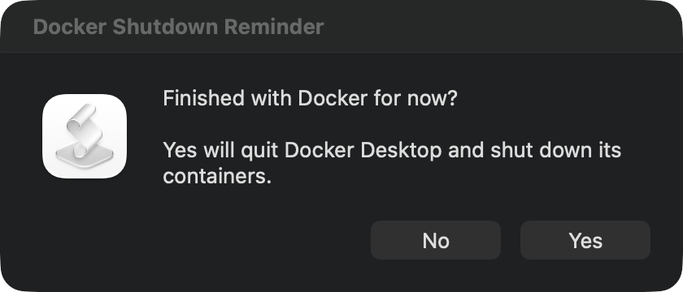

# Docker Shutdown Reminder

A macOS AppleScript reminder to quit Docker Desktop at the end of the workday.

At **17:30 Monday–Friday**, a Yes/No dialog asks whether you have finished with Docker. **Yes** asks Docker Desktop to shut down using its own quit operation. **No**, or Escape, leaves it running. No is the default.



## Schedule and sleep

Times follow your Mac's local time zone. Docker Desktop must be running for the prompt to appear.

| Scheduled reminder | Valid after waking until |
| --- | --- |
| Monday–Thursday, 17:30 | 09:00 the following morning |
| Friday, 17:30 | Monday at 09:00, including all weekend |

macOS delivers a missed scheduled launch when the Mac wakes from sleep. An overdue launch is skipped after its cutoff. An old dialog accepted after its cutoff also does nothing.

Each reminder is offered once per workday window, including if you choose No. There are no additional weekend prompts after you answer Friday's reminder. The Mac is not woken by the schedule. Your graphical user session must be logged in. Missed launches while powered off are not caught up.

## Requirements

- macOS, using its built-in AppleScript and launchd tools.
- Docker Desktop installed at `/Applications/Docker.app`, with support for the `docker desktop stop` CLI command.

## Install

Clone or download this repository, then run:

```sh
git clone https://github.com/deanc/docker-shutdown-reminder.git
cd docker-shutdown-reminder
sh install.sh
```

The installer compiles the AppleScript into a local app, signs it locally, and registers a per-user LaunchAgent. No administrator privileges are needed. Installation does not open the prompt or stop Docker. Run the installer again to update an existing installation.

Installed files:

```text
~/Library/Application Support/DockerShutdownReminder/
~/Library/LaunchAgents/local.docker-shutdown-reminder.plist
```

## Try the prompt

During a valid reminder window, with Docker Desktop running:

```sh
launchctl kickstart "gui/$(id -u)/local.docker-shutdown-reminder"
```

If you already answered in this window, clear its marker before retrying:

```sh
rm -f "$HOME/Library/Application Support/DockerShutdownReminder/last-window"
launchctl kickstart "gui/$(id -u)/local.docker-shutdown-reminder"
```

Choosing **Yes** during a test really quits Docker Desktop.

## Shutdown behavior

The dialog closes immediately and runs this command in the background:

```sh
/Applications/Docker.app/Contents/Resources/bin/docker desktop stop --timeout 60
```

Docker Desktop manages shutdown of its containers, as with its Quit menu action. The reminder does not stop containers individually first and does not use `--force`. The timeout limits the CLI's wait; it is not a container kill timeout. Images, volumes and containers are not deleted.

If the command fails or times out, a failure alert appears. Details are saved to:

```text
~/Library/Application Support/DockerShutdownReminder/shutdown.log
```

## Uninstall

```sh
sh uninstall.sh
```

This removes the schedule. The application, logs and reminder history are retained in the Application Support folder above; you can remove that folder separately.

## Checks

On macOS:

```sh
sh tests/run.sh
```

Checks shell syntax, compiles the AppleScript and verifies 20 scheduling cases, including weekday morning cutoffs, the weekend window and daylight-saving time. These checks do not display the reminder or run Docker commands. Docker Desktop shutdown was also tested manually.

## References

- [Apple: Scheduling Timed Jobs](https://developer.apple.com/library/archive/documentation/MacOSX/Conceptual/BPSystemStartup/Chapters/ScheduledJobs.html)
- [Docker Desktop CLI](https://docs.docker.com/desktop/features/desktop-cli/)
- [docker desktop stop](https://docs.docker.com/reference/cli/docker/desktop/stop/)
